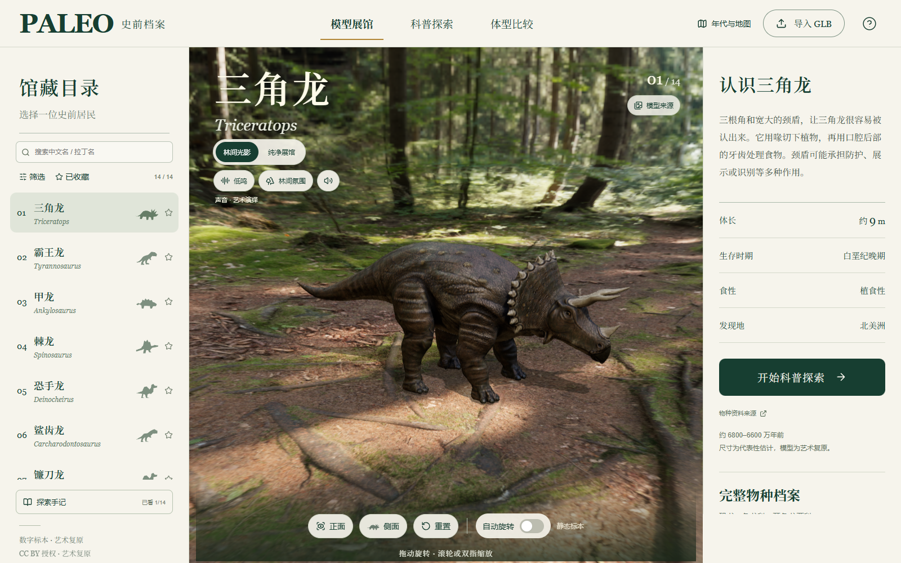
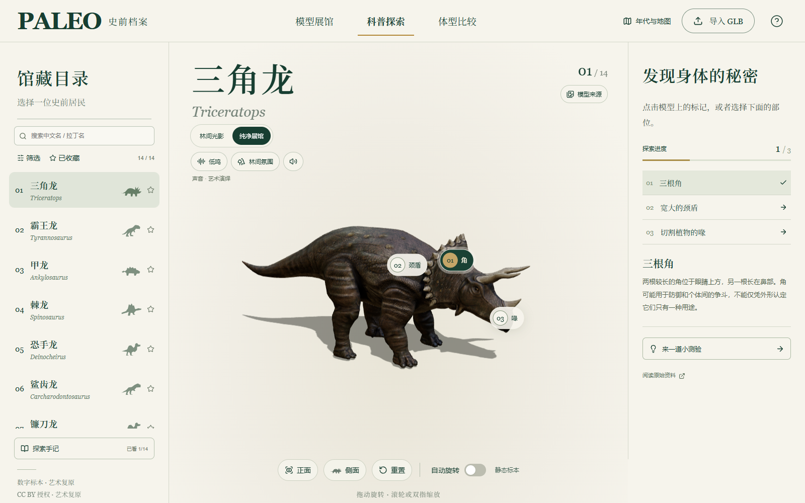
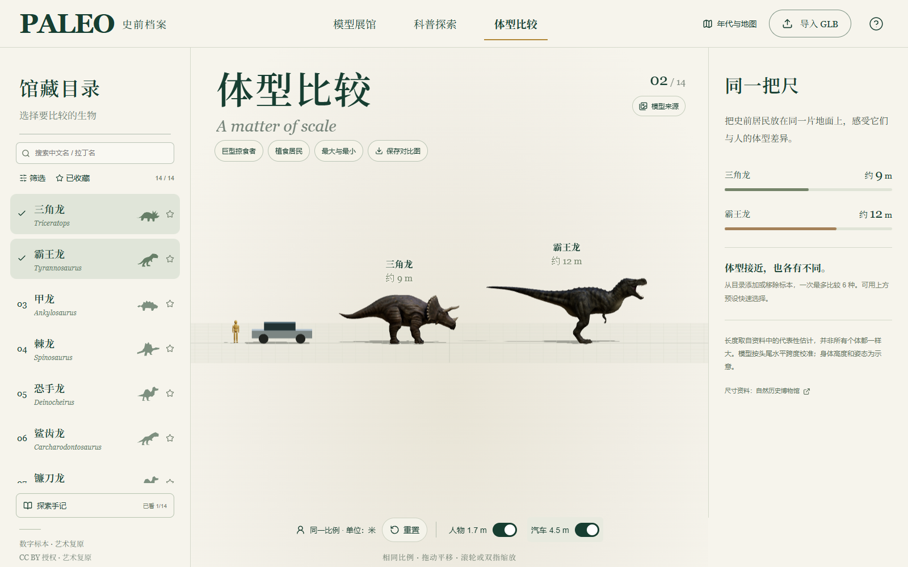
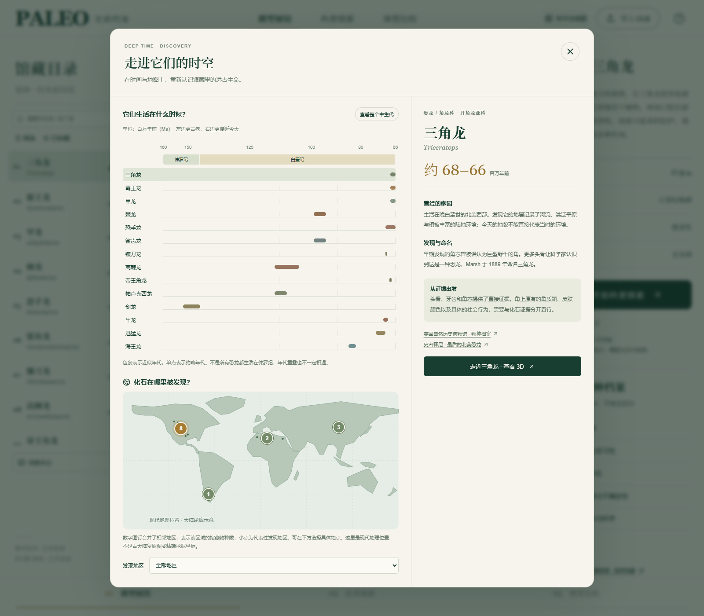
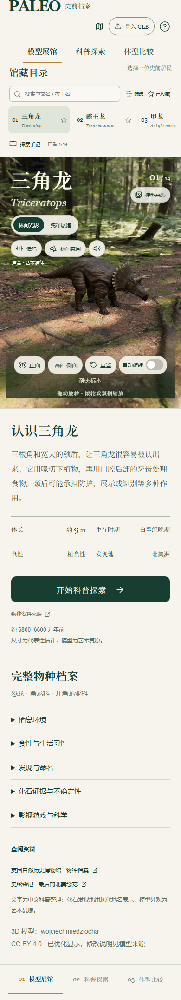

# PALEO · 史前档案

在浏览器里走进史前世界：旋转观察恐龙、探索身体特征、比较体型，再用年代轴与地图认识它们生活的时代。

[](https://github.com/Bindy-lbb/dinosaur/actions/workflows/deploy.yml)

**[在线体验](https://bindy-lbb.github.io/dinosaur/)** · [项目源码](https://github.com/Bindy-lbb/dinosaur) · [素材署名](./ATTRIBUTION.md) · [科普参考](./REFERENCES.md)

纯前端交互式 3D 科普展馆，基于 React、TypeScript、Three.js 和 Vite。内置 14 个带纹理的馆藏条目，无需注册或配置 API Key。

## 页面预览

以下为真实运行页面截图。画面中的第三方模型与环境素材作者、原作链接、许可和修改说明见 [ATTRIBUTION.md](./ATTRIBUTION.md)。

### 模型展馆

拖动旋转、缩放观察，在林间光影与纯净展馆之间切换。



### 科普探索

点击身体特征标记，阅读知识卡片并完成小测验。



### 体型比较

将多种生物放在同一比例下观察，加入人物、汽车参照，并导出附带署名的图片。



### 年代与地图

通过交互年代轴与现代发现地点，串联史前生物的时空分布。



<details>
<summary>查看移动端长截图</summary>



</details>

## 本地运行

需要 **Node.js 22.12+** 和 npm（推荐 Node.js 22 LTS）。首次克隆包含模型、贴图与音频素材，请预留下载时间。

```bash
git clone https://github.com/Bindy-lbb/dinosaur.git
cd dinosaur
npm ci
npm run dev
```

默认访问 <http://127.0.0.1:5173/>。也可以指定端口：

```powershell
npm run dev -- --port 5173
```

构建并预览生产版本：

```bash
npm run build
npm run preview
```

`build` 先执行 TypeScript 检查，再将静态网站生成到 `dist/`；预览地址为 <http://127.0.0.1:4173/>。不要直接双击 `dist/index.html`，模型加载需要 HTTP 服务。

## 功能

- 14 个带纹理的 GLB 馆藏条目：13 个恐龙条目，以及海生爬行动物海王龙。
- 模型展馆：鼠标旋转、缩放、正侧面视角，森林环境 / 纯净展馆切换。
- 科普探索：每个馆藏三个知识标记及小测验；物种档案补充发现、生活环境、取食、证据与参考资料。
- 体型比较：最多选择 6 种标本，正交投影保持相同比例；提供 1.7 m 人物与 4.5 m 汽车参照、快速组合、平移缩放，以及包含署名和来源的 PNG 导出。长度均为教学用近似值。
- 年代与地图：交互时间条、现代发现地点与地区筛选，可直接进入物种档案。
- 馆藏检索：中文名和拉丁名搜索，按年代、食性和动物类别筛选。
- 声音体验：按物种配置咆哮、低鸣或短鸣，配林间 / 海浪循环氛围；点击才加载播放，提供停止、音量与统一静音。切换物种、模式、导入模型或隐藏页面会停止播放，不自动恢复。音量保存在当前浏览器。
- 收藏与探索手记：收藏、已看物种、知识标记及正确答题进度保存在当前浏览器，附主题探索路线；清理浏览器数据后会重置，不提供账号同步。
- 当前 14 个馆藏均为静态模型。霸王龙已换为 Pedro B. Goulart 原作中的独立模型，恢复中立站姿，避免卷尾动作影响体型比较。
- 手机端馆藏目录可左右滑动，桌面目录可滚动；支持通过 `?demo=museum&species=spinosaurus` 等链接直接打开物种。
- 可导入不超过 50 MB、包含贴图的 GLB，浏览器本地解析。

模型、皮肤贴图与 HDRI 均保存于 public，运行时无需连接 Sketchfab 或 Hugging Face。按当前物种加载资产；切换后释放 GPU 资源，原始文件缓存在当前页面内。

## 使用方式

| 操作 | 方式 |
| --- | --- |
| 观察模型 | 桌面拖动旋转、滚轮缩放；触屏拖动旋转、双指缩放 |
| 切换馆藏 | 选择左侧目录；手机端横向滑动目录 |
| 探索特征 | 切换“科普探索”，点击模型上的知识标记 |
| 比较体型 | 切换“体型比较”，选择最多 6 种馆藏；拖动平移、滚轮或双指缩放 |
| 保存比较 | 点击“保存对比图”，下载包含模型署名的 PNG |
| 声音体验 | 手动点击叫声或氛围按钮，音量菜单可统一静音 |
| 导入模型 | 点击“导入 GLB”，选择不超过 50 MB、包含贴图的文件 |

可以分享指定物种或模式的链接，例如：[霸王龙展馆](https://bindy-lbb.github.io/dinosaur/?demo=museum&species=tyrannosaurus)、[棘龙科普探索](https://bindy-lbb.github.io/dinosaur/?demo=explore&species=spinosaurus)、[体型比较](https://bindy-lbb.github.io/dinosaur/?demo=compare)。

## 部署到 GitHub Pages

本仓库使用 [GitHub Actions 工作流](./.github/workflows/deploy.yml) 自动构建和部署，线上地址为 **<https://bindy-lbb.github.io/dinosaur/>**。

1. 在仓库 **Settings → Pages → Build and deployment** 中，将 **Source** 设为 **GitHub Actions**。
2. 向 `main` 分支推送代码，或在 **Actions → Deploy to GitHub Pages → Run workflow** 手动运行。
3. 工作流执行 `npm ci`、`npm run build`，上传 `dist/` 并发布到 Pages。部署结果可在 Actions 和仓库的 `github-pages` 环境查看。

Vite 使用相对资源基路径 `base: "./"`，模型、HDRI、音效和署名链接均随部署目录解析，兼容 `/dinosaur/` 项目路径。本地开发仍使用根路径；页面状态通过查询参数保存，无需服务端路由重写。

Fork 后部署时，在自己的仓库开启 Pages，并将 README 中的仓库地址、徽章与在线体验链接替换为自己的地址。其他静态托管平台也可以直接发布 `dist/`。

部署配置参考 [Vite 静态部署文档](https://vite.dev/guide/static-deploy.html#github-pages) 和 [GitHub Pages 自定义工作流文档](https://docs.github.com/en/pages/getting-started-with-github-pages/using-custom-workflows-with-github-pages)。

## 技术与目录

| 技术 | 用途 |
| --- | --- |
| React 19 + TypeScript | 页面组件、交互状态与类型检查 |
| Three.js | GLB 加载、灯光、场景、模型交互与图片导出 |
| Vite | 开发服务、代码分块与静态构建 |
| Lucide React | 界面图标 |
| GitHub Actions + Pages | 自动构建与网站托管 |

```text
├── .github/workflows/deploy.yml  # 自动部署
├── docs/screenshots/            # README 实际页面截图
├── public/
│   ├── models/                  # 14 个 GLB 模型与署名清单
│   ├── environment/             # 森林 HDRI
│   ├── audio/                   # 叫声、环境声与素材许可
│   └── references/              # 早期二维 AI 参考图
├── src/
│   ├── components/              # 展馆、馆藏目录、地图与资料界面
│   ├── data/                    # 物种、知识卡片、声音和学习进度
│   └── three/                   # 场景引擎与模型加载
├── ATTRIBUTION.md               # 素材作者、许可与修改记录
└── REFERENCES.md                # 科普内容参考资料
```

## 馆藏清单

| 馆藏 | 展示体长 | 模型作者 |
| --- | --- | --- |
| 三角龙 Triceratops | 9 m | wojciechmiedziocha |
| 霸王龙 Tyrannosaurus | 12 m | Pedro B. Goulart / Pebegou |
| 甲龙 Ankylosaurus | 8 m | pikabobalex |
| 棘龙 Spinosaurus | 14 m | Julian Johnson-Mortimer |
| 恐手龙 Deinocheirus | 10 m | Julian Johnson-Mortimer |
| 鲨齿龙 Carcharodontosaurus | 12.5 m | Julian Johnson-Mortimer |
| 镰刀龙 Therizinosaurus | 10 m | Julian Johnson-Mortimer |
| 高棘龙 Acrocanthosaurus | 12 m | Julian Johnson-Mortimer |
| 帝王角龙 Regaliceratops | 5 m | Julian Johnson-Mortimer |
| 帕卢克西龙 Paluxysaurus（旧名） | 18 m | Julian Johnson-Mortimer |
| 剑龙 Stegosaurus | 9 m | PAndras |
| 牛龙 Carnotaurus | 8 m | Cenker Turhan |
| 迅猛龙 Velociraptor | 1.8 m | Tomas Ibar |
| 海王龙 Tylosaurus（非恐龙） | 13 m | Julian Johnson-Mortimer |

## 来源与限制

模型作者、许可链接及修改说明见 [ATTRIBUTION.md](./ATTRIBUTION.md) 和 `public/models/credits.json`，页面“模型来源”也可查看。

14 份模型分别采用 [CC BY 4.0](https://creativecommons.org/licenses/by/4.0/)，森林 HDRI 采用 [CC0](https://polyhaven.com/license)。版权仍属于原作者；使用或再分发模型时，保留作者署名、原作与许可链接，并标明修改。授权以每份资产的原作记录为依据，不能从素材档案库的整体许可推断。

本次新增资产已做网页优化：简化网格、将贴图转为 WebP（最大 2048 像素），并保留原作署名元数据。牛龙移除了独立岩石；高棘龙和帝王角龙重算法线；帕卢克西龙转换了旧版材质；镰刀龙保留原作的幼体。各文件的实际大小、SHA-256 和完整变更记录见署名文件。

模型是艺术复原，尚未经过古生物学专业审核；自然环境只是氛围展示。尺寸按模型姿态中的头尾水平跨度校准，不是严格的骨骼测量。

音效使用 OpenGameArt 的 CC0 素材（2 份叫声、2 份氛围），在播放时调整音量、速度和音高。14 个物种的声音来自不同播放参数，并非 14 份独立录音，也不代表真实发声的科学复原。音频按需从站内 `audio/` 加载，无外站播放请求；原作、许可、文件校验及处理说明见 [音效清单](./public/audio/credits.json)。桌面 Edge 可直接播放；移动端实际音量控制还受浏览器及系统设置影响。

迅猛龙模型沿用无羽毛的传统艺术造型，与支持羽毛的化石证据存在差异。帕卢克西龙保留模型旧名，其相关材料现通常归入波塞东龙。海王龙属于沧龙科海生爬行动物，并非恐龙。镰刀龙原作中的成幼体组合也不能用来证明特定群居或育幼行为。

电影及《方舟》中的名称可以帮助识别物种，但虚构习性不等于科学事实，作品中的模型、图像和音效也不因此获得使用许可。本馆没有选用已识别为游戏或电影提取物的资产。

这是免费的实时展示资产，细节与电影级复原仍有差距。旧版二维 AI 参考图保留在 public/references，但当前页面不把它们当作 3D 模型使用。

当前导入功能不配置 Draco / Meshopt / KTX2 解码器，也不播放任意导入文件的动画。内置资产已经处理为当前加载器支持的格式。

仓库公开可供浏览，但当前未为项目代码指定开源许可证；第三方素材按各自许可使用，不能将其统一视为项目代码的授权。

## 常见问题

- **页面有文字，但没有模型**：使用支持 WebGL 的现代浏览器并开启硬件加速；初次访问需要下载模型和贴图，请等待加载完成。网络失败可刷新重试。
- **声音没有自动播放**：点击叫声或环境声按钮开始播放；检查站点音量、系统音量与静音设置。
- **收藏或进度消失**：数据保存在当前浏览器的本地存储中，清理站点数据、切换浏览器或使用无痕模式都会影响保留。
- **导入 GLB 失败**：文件需不超过 50 MB，并内嵌所需贴图；当前加载器不支持额外的 Draco / Meshopt / KTX2 解码流程。
- **更新后线上仍是旧版本**：先确认 Actions 中的部署已成功，再刷新页面；浏览器缓存和部署传播可能造成短暂延迟。
